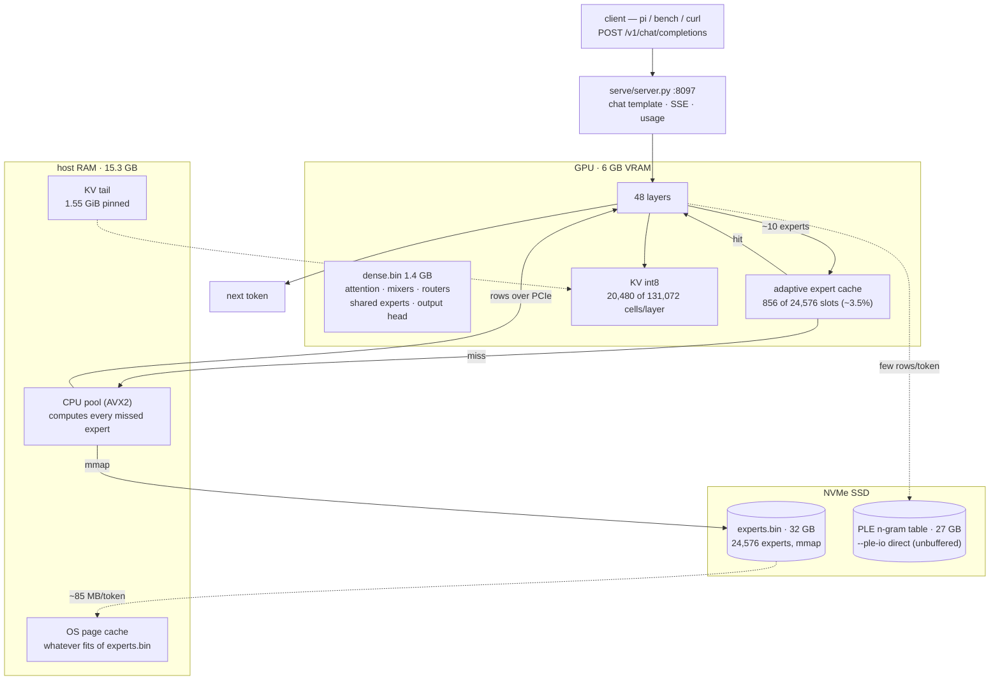

# strata-at-6gb-vram

**Goal:** run **Qwen3.8-Flash-Next** (177B-parameter MoE, Q2_0 2.25-bit GGUF) on a laptop with
**6 GB VRAM / 15 GB RAM** — far below Strata's requirements — by streaming the experts from the
NVMe SSD through the OS file cache (Strata's low-RAM `mmap` mode).

Reference point: [Reddit: *QFN Q_2 strata configs for 8gb vram and 32gb ram*](https://www.reddit.com/r/LocalLLaMA/comments/1x5p822/)
— RTX 3070 8 GB + 32 GB DDR4 → 36 tok/s decode, 340 tok/s prefill at 176k context with
`--expert-cache 2000 --resident-experts --kv q4_0 --kv-resident 20480 --adapt-* ...`.
This project measures what the SSD-streaming fallback actually does on roughly half of that box.

**TL;DR.** It runs: 6/6 on the short-python-v1 suite, **7.8 tok/s** decode, **51–54 tok/s** cold
prefill, 131k context, **~85 MB of SSD reads per generated token**, 856 of 24,576 experts resident.
Two changes made it viable on a card this small: **KV streaming** (`--kv int8 --kv-resident`) buys
context with pinned host RAM instead of VRAM, and **conversation parking**
(`--conversation-cache-mib 1024`) turns a 107 s agent turn into a 1–2 s one. Everything else is
Strata doing what Strata does.

**Contents:** [Machine](#machine) · [Quick start](#quick-start) · [Methodology](#methodology) ·
[Results](#results) · [Reproducing on another box](#reproducing-on-a-different-box) ·
[License and credit](#license-and-credit) — the running record and fallback options live in
[`LOG.md`](LOG.md).

## Machine

| | |
|---|---|
| GPU | RTX 4050 Laptop, 6 GB VRAM, sm_89, driver 580.178.04, PCIe 4.0 x8 |
| RAM | 15 GB + 4 GB swap (swap was ~100% used before this experiment) |
| CPU | i5-13420H, 8C/12T, AVX2 (no AVX-512) |
| Disk | NVMe, ~140 GB free at setup time |
| OS | Ubuntu 24.04, Python 3.12, CUDA 12.8 toolkit |

## Quick start

```bash
git clone https://github.com/Niko1221/Strata Strata
cd Strata && git checkout 477ac13cbe8e582c20484871ce459d20d82df09d   # v0.1.45
cd ..

./scripts/build.sh    # pin the engine, then download + prepare the weights (~102 GB)
./scripts/run.sh      # start the server on :8097
./tools/bench-strata.py --base-url http://127.0.0.1:8097 --wait 600
```

`scripts/run.sh` writes the tuned launch config (the exact flags in *Methodology §3*) from
`config/strata-q2_0.json.template`. Override anything with env vars:

| Env var | Default | What it is |
|---|---|---|
| `ROOT` | repo directory | where `Strata/` and `Strata-data/` live |
| `DATA_DIR` | `$ROOT/Strata-data` | shards, packs, MTP draft |
| `PORT` | `8097` | this box uses 8097 because SearXNG owns 8080 and kubectl port-forwards own 8081–8082; pick any free port on yours |
| `CONTEXT` | `131072` | `--max-context` |
| `EXPERT_PROFILE` | `Strata/data/expert-profile.bin` | routing-frequency profile that seeds the cache |

Model data is **not** in the repo (102 GB). `data/MANIFEST.json` lists the exact files the setup
downloaded and prepared, so you can verify a run against the same weights.

## Setup verdict

`./setup.sh --check` refuses all sizes, then the real run warns and proceeds on explicit
`--model Q2_0 --yes` ("installs one anyway, slowly"):

- `[!] less than 12 GB of VRAM: Strata will run, but most experts stay on the CPU and it will be slow`
- `[!] RAM: 15 GB — the smallest model (the Coder) needs about 32 GB … the OS will page them from disk. Expect it to be very slow, and it may not start at all.`
- Low-RAM mode: **Q2_0's 34 GB of experts are read from the model folder through the OS file cache; the GPU holds ~3% of them** (≈700 experts of 24,576).

Setup command used (reproducible):

```bash
cd Strata
./setup.sh --model Q2_0 --context 32768 --vision no --low-ram mmap \
  --data-dir "$ROOT/Strata-data" --no-start --yes
```

- No ready-made engine for v0.1.45 (HTTP 404) → compiled from source for `sm_89`
  (CUDA 12.8, `-DSTRATA_MMQ_KQUANTS=ON -DSTRATA_Q6K_EXPERTS=ON`).
- Download: 2 shards, 66.4 GB total; pack `experts.bin` (+34 GB); MTP draft (~5 GB).
- Full transcript: `logs/setup-q2_0-20261017.log`.

### Local modifications (this project only)

- `download-throttle.patch` — caps `setup.py`'s downloader at **3.5 MiB/s**
  (`STRATA_DOWNLOAD_MAX_MIBPS`, `0` disables) so the 66 GB pull stays under the 4 MiB/s the link
  owner asked for. Reapply after a `git pull`: `git apply download-throttle.patch`. The first
  attempt also died once when the session changed workspaces (harness-tracked background job); the
  download is resumed by a detached wrapper (`setsid` + retry loop `seq 1 12`).

## Layout

```
README.md                      goal, quick start, methodology, results
LOG.md                         the running record: timeline, fallbacks, open items
results.md                     short-python-v1 runs, per task, with attribution
config/                        the tuned launch config (template)
scripts/                       build.sh, run.sh — reproduce the exact stack
tools/                         bench-strata.py, reuse-test.py, stream-stat.sh
data/MANIFEST.json             the model files this project used (names, sizes, source)
logs/                          setup transcript and server console (evidence)
results/                       JSON/CSV output of every measured run
Strata/                        engine checkout (github.com/Niko1221/Strata) — gitignored
Strata-data/                   model shards, pack (experts.bin), MTP draft — gitignored
download-throttle.patch        our downloader patch
AGENTS.md                      notes for the agent driving this box
```

---

## Methodology

A ~63 GB model, 6 GB of VRAM, 15 GB of RAM. Everything here is an answer to two questions:
**which** 6 GB, and what never gets read at all. To claim anything about the numbers, the two
contributors have to be separated: **what Strata's engine does by design**, and **what this project
changed to make it fit a box the engine refuses**. Both are below, with the evidence for each.

### 1. The data path — where the model actually lives

The model is not "loaded". It is split across three tiers, and only a fraction of it is ever in
memory:

| Piece of the model | On disk | Where it lives here |
|---|---:|---|
| Dense weights — attention, DeltaNet mixers, routers, gated residuals, shared experts, output head | 36 GB GGUF → `dense.bin` **1.4 GB** | **VRAM**, always resident |
| Routed experts — 24,576 of them, ~10 asked per token | `experts.bin` **32 GB** | **NVMe**, streamed; 856 slots mirrored in VRAM |
| PLE n-gram table — the output-side lookup | **27 GB** GGUF | **NVMe**, read *unbuffered* past the OS cache, a few rows per token |
| KV cache, `int8` | — | 20,480 of 131,072 cells/layer in **VRAM** (the flag's minimum), the rest in **1.55 GiB pinned RAM** |

Total SSD footprint is ~96 GB (63 GB of GGUFs + a 33 GB prepared pack) to run a model that needs
63 GB of weights in a 6 GB card.

#### One generated token



(Rendered PNG of the same graph: `results/one-token-flowchart.png`.)

Reading the diagram left to right, the two facts that decide every number in this repo:

1. **A miss is a disk read, not a compute stall.** The engine's own accounting reports
   "492 µs per missed expert" for a 1.32 MB expert. That *is* the read time — the CPU pool is not
   slow, the SSD is the bottleneck. Sustained decode traffic measured **83–89 MB per generated
   token** (~1.5 GB/s) via `tools/stream-stat.sh`, which samples `/proc/<pid>/io read_bytes`
   (bytes actually fetched from storage; page-cache hits are excluded).
2. **Prefill is a number of passes, not a throughput.** Prompt chunks are read in blocks
   (`--prefill auto`), and a chunk of N tokens routes to essentially every expert in every layer —
   so **each chunk is a full pass over the 32 GB expert set**. An 1,843-token prompt read 51 GB:
   two passes at chunk 1280, four at the engine's initial chunk 512. Prefill cost is therefore
   `ceil(prompt / chunk)` passes of ~25 GB at ~1.9 GB/s, which is why chunk size and prefix reuse —
   not the plumbing — set prompt speed.

### 2. What Strata does (we did not change any of it)

The architecture that makes a 177B MoE with ~10 of 24,576 experts per token fit in 6 GB is the
engine's. These are its principles, and every one of them is running at its default here:

1. **The model is mostly a lookup table of specialists.** 24,576 experts, ~10 consulted per token.
   Sparsity is the lever that makes everything else possible.
2. **Tier it, and promote what's hot.** VRAM keeps the frequently-used experts in an **adaptive**
   cache that re-learns which ones matter as the conversation moves (`--expert-cache auto`, seeded
   from the routing-frequency **profile** in `Strata/data/expert-profile.bin`).
3. **Both processors work at once.** The GPU computes its cached experts while the CPU computes the
   missed ones *in place*, shipping results over PCIe. The PCIe share auto-adapts from the CPU's
   measured speed (0.30 → 0.60 on this box, `STRATA_PREFILL_CPU_SHARE` at its default).
4. **Guess, then check.** Suffix/prompt-lookup drafting (`--spec`) is verification in one pass; the
   output is unchanged. 3–5 of 5–12 drafts accepted per window when drafting pays.
5. **Read long inputs in big chunks**, overlapped with attention (`--prefill auto`).
6. **Keep the conversation** so follow-ups only read what is new — parking is engine machinery,
   opt-in and **off by default** (`--conversation-cache-mib 0`).
7. **Approximate what cannot fit.** `STRATA_ROUTE_TAIL_SKIP=7` is ON by default on CUDA: missed
   experts ranked below a window's weakest draft are skipped, and answers differ slightly. Expert
   cache hits also round differently from CPU misses (documented parity in the engine repo). We
   left both on and report them as caveats, not as wins.

**Defaults we deliberately left alone and measured:** `--expert-cache auto`, `--prefill auto`,
`STRATA_PREFILL_CPU_SHARE`, `STRATA_ROUTE_TAIL_SKIP`.

### 3. What we changed to make it fit, and why

Nine deltas. Each one is a decision against a documented Strata behaviour, with the measurement
that justified it.

| # | Lever | Strata default | What we set | Why | Measured effect |
|---|---|---|---|---|---|
| 1 | build | prebuilt binaries | compile from source, `sm_89`, CUDA 12.8, `-DSTRATA_MMQ_KQUANTS=ON -DSTRATA_Q6K_EXPERTS=ON` | no prebuilt engine for v0.1.45 (HTTP 404), and this GPU is not in any of them | engine commit `477ac13c` runs on this card |
| 2 | expert tier | resident expert arena | `--mmap-experts` (opt *out*) | 32 GB of experts cannot be pinned in 15 GB; the RAM tier holds nothing (`RAM 0 blobs`) | the documented A/B arm: 71.97 ms/token cold vs 34.78 warm |
| 3 | context | 32,768 from setup | `--max-context 131072 --kv int8 --kv-resident 20480` | 32k died on the first request (`verify: instantiate: out of memory`); 16k worked; streaming KV puts the extra context in **pinned host RAM, not VRAM** | 16k → 131k, i.e. 8× the context, for −24% decode |
| 4 | draft head | `--mtp` (839 MiB) | dropped, `--spec 4 --spec-min-p 0.5` | the MTP layer starved the native head upload (`out of memory`); IQ packs still require `--spec >= 2`, so suffix drafting survives | same as the Reddit poster's "sacrifice MTP" |
| 5 | VRAM reserve | `--vram-reserve-mib 700` | `512` (with `--kv-resident` at its 20,480 minimum) | free VRAM is what `--prefill auto` converts into cache slots and chunk buffers | expert cache **599 → 856 slots**, prompt chunk **512 → 1280**, cold prefill **41.6 → 51–54 tok/s** (+23–30%) |
| 6 | conversation parking | off (`--conversation-cache-mib 0`) | `1024 MiB`, 4 slots, `min-tokens 128`, `park-gain 512` | without it every agent turn re-reads the whole conversation from SSD | a 5.2k-token turn: **107 s → 1–2 s** (5,208 of 5,229 tokens reused) |
| 7 | VRAM reclaimed | — | closed an unrelated app (`tern`, 892 MiB) | the cache is sized by what is actually free | expert cache 344 → **599 slots** |
| 8 | download | unthrottled | `download-throttle.patch` → 3.5 MiB/s | keep a 66 GB pull inside the link's 4 MiB/s limit | 66 GB pulled without saturating the link |
| 9 | port | 8080 | **8097** (`PORT` in `scripts/run.sh`) | SearXNG owns 8080 on this box, kubectl port-forwards own 8081–8082 | environment detail, not a tuning win |

> **Pinning the engine.** The revision is the commit in `scripts/build.sh`
> (`477ac13cbe8e582c20484871ce459d20d82df09d`, tag `v0.1.45`); the script fetches it if the
> checkout is shallow and detaches, so a moving `main` cannot drift under a reproduction. Note
> that `Strata/engine/BUILD.json`'s `"src"` field is **not** a revision — `setup.py`'s
> `source_hash()` stores a 16-hex sha256 fingerprint of the engine sources, used to decide when a
> `git pull` requires a rebuild (upstream issue #31).

#### Delta 3 in detail: the context ladder nobody would have guessed

`--max-context` was not a knob you can turn up on a 6 GB card. The ladder, one variable at a time:

| `--max-context` | KV mode | Expert slots | Decode | Prefill (cold 293-tok prompt) |
|---|---:|---:|---:|---:|
| 32768 | setup default | — | *died*: `verify: instantiate: out of memory` | — |
| 16384 | int8, fully resident | 344 | 9.0–9.9 tok/s | 16.4 tok/s |
| 65536 | int8, resident | 387 | 9.9–12.0 tok/s | 15.8 tok/s |
| 65536 | int8 + `--kv-resident 32768` | 686 | ~9.9 tok/s | 19.7 tok/s |
| **131072** | **int8 + `--kv-resident 20480`** | **856** | **7.4–7.8 tok/s (suite)** | **51–54 tok/s (retuned)** |

Only change between rows 1–3 was closing `tern`, freeing 892 MiB. KV streaming keeps 20,480 of
131,072 cells per QSA layer in VRAM and the tail in **1.55 GiB of pinned RAM**; 99.2–99.6% of KV
block reads still hit VRAM. Post-load RAM is ~9.4 GB of the 15.3 GB guard.

`--kv-resident 20480` is the flag's documented **minimum**, and both reductions (reserve 700→512,
resident 32768→20480) go straight into the expert cache and the prompt chunk. That is the whole
mechanism of delta 5.

**Honest caveat on delta 5.** The engine still prints its #2065 warning — `262 MiB of VRAM free
with everything loaded (below 512 MiB)` — so the driver can in principle page GPU memory and
collapse decode. The reserve is exactly what buys the chunk and the cache, so this is a deliberate
trade, not an oversight: no instability appeared across the requests measured, but
`--vram-reserve-mib 512` is the aggressive part of this config and the first thing to raise if
anything goes strange.

#### Delta 6 in detail: parking, and why `park-gain` is not cosmetic

A real role-based multi-turn conversation — the shape an agent actually sends — against the live
server (`tools/reuse-test.py`):

| Turn | Prompt tokens | Wall | Engine's own accounting |
|---|---:|---:|---|
| 1 — cold | 5,207 | 107.3 s | `0 reused + 5207 read in 106966 ms (48.7 tok/s)` |
| 2 | 5,229 | **2.04 s** | `5208 reused + 21 read in 1812 ms` |
| 3 | 5,229 | **1.37 s** | `5200 reused + 29 read in 1203 ms` |
| 4 | 5,229 | **1.14 s** | `5200 reused + 29 read in 1016 ms` |

On a 6,422-token conversation: 119.5 s cold, then 1.82 s and 1.33 s. Warm turns also *decode*
faster (9–17 tok/s) than the suite's 7.4, because they are no longer re-reading history.

End to end in the real harness, Pi doing the same file task — before and after. Before (parking
off, chunk 512): **`0 reused` on all five turns**, prompts of 2,506 / 2,709 / 2,872 / 2,892 / 3,026
tokens each re-read in full at 101–121 s apiece. After:

| Pi request | prompt | Engine |
|---|---:|---|
| 1 — cold system prompt + task | 2,485 | `0 reused + 2485 read in 51336 ms (48.4 tok/s)` |
| 2 — after the tool result | 2,672 | `2543 reused + 129 read in 10589 ms` |
| 3 | 3,162 | `3128 reused + 34 read in 3646 ms` |
| 4 | 3,461 | `3318 reused + 143 read in 12385 ms` |

Two things a reader should understand before reusing these flags:

- **The cost of fresh tokens is not flat.** It follows the experts the fresh span routes to: ~90 ms
  per fresh token at the short end (a 21-token delta touches ~172 of 512 experts per layer → 1.8 s)
  saturating at one full pass (~13–20 s) once the delta passes ~400–500 tokens and touches every
  expert in every layer again. An agent turn with a small tool result costs seconds; one that
  injects a large file costs about what that file costs cold.
- **`--conversation-cache-park-gain 512` is load-bearing.** With the default (park every turn) each
  turn wrote a fresh **429 MB** snapshot and evicted the previous one — three evictions of a 1,024
  MiB budget in three turns. With the gain set, turns that advance by a few dozen tokens reuse the
  parked copy and park nothing. Reuse is checkpoint-granular: the engine checkpoints at the last
  `<|im_start|>` (turn boundary) plus every `--prompt-cache-every` (default 16,384) fresh tokens,
  so a client that rewrites its recent history mid-conversation re-reads from the last checkpoint it
  can match — which is why a byte-identical prompt reuses instantly (0.4 s) even with parking off,
  while a prefix-extending turn needs parking on.

A parked 5,229-token conversation measures 429 MB, so the 1,024 MiB budget holds about two of them
(`--conversation-cache-slots 4` is the count, `--conversation-cache-min-free-mib` the RAM floor).

### 4. Levers we tested and rejected

Null results are part of the methodology. These were tried on the same box, same protocol:

| Lever | Expected win | Result here | Why it did not work |
|---|---|---|---|
| `--expert-cache-per-layer` | the doc's headline fix — arrival-order fill wastes slots on position-0 experts (2.97% → 21.4% hits) | **neutral**: 43.7% → 44.4% hits, prefill 35.9 → 38.2 s | our cache is already filled from the routing-frequency **profile**, which is the good policy this flag exists to approximate |
| `--resident-cpu-experts` | pin hot experts in RAM | engine declined to engage it (`RAM 0 blobs`, unchanged); swap hit 100% | its own guard: those experts are pages of a 30.5 GiB file with only ~7 GiB of RAM to keep them |
| `--spec 6` | more drafting | neutral or worse | longer draft windows do not pay when verification is one full pass |
| `--kv q4_0` | smaller KV | no improvement | KV is already not the constraint; the tail is pinned RAM, not VRAM |
| `--adapt-async 1` | overlap adaptation | neutral | — |
| `STRATA_PREFILL_CPU_SHARE=auto` | prefill +13% | **+13% prefill, but swap hit 100%** | 31.2 GiB of file pages vs 7.6 GiB free RAM — rejected |
| chunk 2048 | one fewer pass | would barely help | a 2,506-token prompt is two passes at chunk 1280 **and** two at 2048. Only a chunk ≥ the prompt buys one pass, and that needs ~0.67 MiB of chunk buffers per token — 21 GiB at 32k. Not on a 6 GB card |

### 5. How each number was measured

| Tool | Measures | How |
|---|---|---|
| `tools/bench-strata.py` | prefill rate, decode rate | three `POST /v1/chat/completions` calls at `temperature 0`: long prompt + `max_tokens=1` (prefill), same prompt + generate (decode), short prompt + generate. Rates are taken from the server's own `timings` block (`prompt_per_second`, `predicted_per_second`, which already exclude prefill from decode) and fall back to wall-clock tokens/second over the whole request; the source used is recorded per field in the output. Stdlib only; samples `/proc/meminfo` before and after |
| `tools/reuse-test.py` | prefix reuse in the shape an agent sends | role-based multi-turn conversation, one request per turn; parses the engine's own `prompt N tokens = R reused + F read in T ms` line from the log |
| `tools/stream-stat.sh` | SSD bytes/token, RSS, swap, page faults, VRAM | samples `/proc/<pid>/io read_bytes` (storage only, page-cache hits excluded), `/proc/<pid>/stat` majflt/minflt, and `nvidia-smi --query-compute-apps` |
| `results.md` + workbench `short-python-v1` | end-to-end usefulness | 6 Python tasks, greedy (`temperature 0`, `reasoning_effort low`, `max_tokens 1024`, `seed 42`), code block extracted, executed, compared against expected output |
| engine's own accounting | cache hit rate, chunk size, PCIe share, tail skip | read from the server log emitted per request |

**Attribution.** Every number characterises the **whole stack**: Strata's engine design (tiered
expert cache, SSD streaming, CPU pool, KV streaming) as configured for a 6 GB card. Running a 177B
MoE on 6 GB is only possible because of that design — the architecture is Strata's. The tuning
deltas above (context ladder, VRAM retune, parking, no MTP) are this project's. The tests exercise
Strata's OpenAI-compatible surface exactly as a real client would.

### 6. What this methodology cannot claim

- **One box, one session.** All numbers are from a single RTX 4050 Laptop / 15 GB machine on one
  day. No cross-hardware validation.
- **Run 1 vs run 2 is not a clean A/B.** Run 1 (16k) ran ~80 min earlier in a long session, so part
  of the −24% could be thermal drift rather than the KV mode. A back-to-back A/B would separate
  them; we report the gap as measured, not as proven.
- **Approximations are active.** `STRATA_ROUTE_TAIL_SKIP=7` skips low-rank missed experts, and
  cache hits round differently from CPU misses. Answers differ slightly from a full-precision run;
  the 6/6 suite passes *with* those approximations on.
- **Decode is storage-bound, not compute-bound.** The engine's own line for one request: "the OS
  read 5,665 MB from storage (44,572 major faults) for 27,763 MB of expert reads". Rates are NVMe-
  and page-cache-dependent and will move on a different drive.
- **Swap is already ~100% used and there is no root.** No extra swap, no VFS tuning, no kernel
  knobs — the tuning space is exactly the engine's flags.
- **The PNG/mermaid diagram is a data-path sketch**, not a measured call graph: the PLE table and
  KV tail are drawn as edges, not profiled paths.

---

## Results

Full per-task tables and raw run paths are in [`results.md`](results.md). Headline numbers:

| Metric | Value |
|---|---:|
| Decode, steady 48–64 token generations | **9.0–9.9 tok/s** (16k context), **7.4–7.8 tok/s** (131k) |
| Prefill, cold 293-token prompt | 16.4 tok/s (18.0 s) |
| Prefill, retuned (chunk 1280) | 51–54 tok/s on 1,843- and 6,422-token prompts |
| Prefill, warm (288/293 tokens reused) | 53.6 tok/s |
| Expert cache hit rate | 24.7–51.6% (344–856 slots of 24,576) |
| SSD reads, steady decode | **~83–89 MB per generated token** (~1.5 GB/s sustained) |
| Expert bytes touched per request | 18.9–27.8 GB (page cache + storage) |
| RSS / swap / VRAM | ~7.9 GB / ~210 MB / 4.7 GiB used (146–284 MiB VRAM free) |
| Suffix drafts accepted | 3–5 of 5–12 per window when drafting pays |

### short-python-v1 (three runs, all 6/6)

| Run | Context | Expert slots | Result | Decode (token-weighted) |
|---|---|---:|---|---:|
| 1 | 16k, KV fully resident | 344 | **6/6** | **9.72 tok/s** |
| 2 | 131k, KV streamed | 599 | **6/6** | **7.40 tok/s** |
| 3 | 131k, retuned + parking on | 856 | **6/6** | **7.81 tok/s** |

**The honest price of context is −24%** (9.72 → 7.40), measured with an identical protocol — spot
samples had suggested only ~0.5–1 tok/s, so the suite is the number to trust. Run 3's **+5.5%** is
the larger expert cache (599 → 856 slots, ~50% vs ~44% in-request hit rate). No truncations
anywhere: every task finished `finish_reason=stop`. Same box, same day, llama.cpp CPU-MoE runs for
scale: Gemopus-4-26B 5/6, KAT-Coder V2.5 4/6.

For reference, the Reddit box (RTX 3070 8 GB / 32 GB DDR4, 2,000 experts cached, 176k context):
36 tok/s decode, 340 tok/s prefill. This box: ~1/4 of the decode, ~1/20 of the prefill, half the
VRAM, half the RAM, and 85 MB/token of SSD traffic.

### Agent harness: Pi driving the 177B

[Pi](https://pi.dev) (`@mariozechner/pi-coding-agent` 0.73.1) was wired to this server as a custom
provider — `~/.pi/agent/models.json`, provider `strata` → `http://127.0.0.1:8097/v1`,
`openai-completions`, 131,072 context, `reasoning: true` with thinking levels mapped onto Strata's
own vocabulary (`off→none`, `low`/`medium`/`high`), and `compat.supportsDeveloperRole: false`
because Strata's chat path folds `system`, not `developer`, into the template.

The test: a scratch repo with a real bug (`median()` wrong for even-length input). Reproduce, fix,
prove it.

| Turn | What it did | Tool | Input | Output |
|---|---|---|---:|---:|
| 1 | located the file | `bash` | 2,506 | 56 |
| 2 | read `stats.py` | `read` | 2,709 | 36 |
| 3 | patched the even-length branch | `edit` | 2,872 | 154 |
| 4 | verified with python | `bash` | 596 | 84 |
| 5 | reported the change | — | 698 | 120 |

It read the file, edited exactly the broken branch to
`(values[n // 2 - 1] + values[n // 2]) / 2`, ran the assertion and got `2.5`. Four
`finish_reason: tool_calls` rounds and a clean `stop` — tool calling, tool results and streaming all
hold up end to end through the OpenAI-compatible surface, driven by a 2-bit 177B with 599 of 24,576
experts cached on a 6 GB card.

## Reproducing on a different box

The methodology is portable; the numbers are not. What to change:

1. **Port** — `PORT=8080` if nothing else is listening.
2. **`--vram-reserve-mib`** — raise toward 896 if the engine's #2065 VRAM-paging warning appears;
   lower only if you are willing to risk decode collapse.
3. **`--max-context` / `--kv-resident`** — walk the ladder (16k → 65k → 131k) and stop at the first
   size that survives the first request; the reserve is what pays for it.
4. **`--resident-cpu-experts`** — worth trying if you have ≥32 GB RAM; on this box the engine
   declines it outright.
5. **`--mtp`** — turn it back on once the native head upload fits; it is the only thing we removed
   that had no measured cost elsewhere.

## License and credit

- **Strata** (engine, architecture, all of the tiering/streaming/drafting design) —
  [github.com/Niko1221/Strata](https://github.com/Niko1221/Strata), MIT, Niko1221 and contributors.
  This project builds it at commit `477ac13cbe8e582c20484871ce459d20d82df09d` (tag `v0.1.45`) and
  applies one patch
  (`download-throttle.patch`). Model weights are ISTA-DASLab's GGUF quant under their own license.
- **Everything else in this repo** (tooling, configs, measurements, write-up) — MIT, see
  [`LICENSE`](LICENSE). See [`CREDITS.md`](CREDITS.md) for the attribution breakdown.
